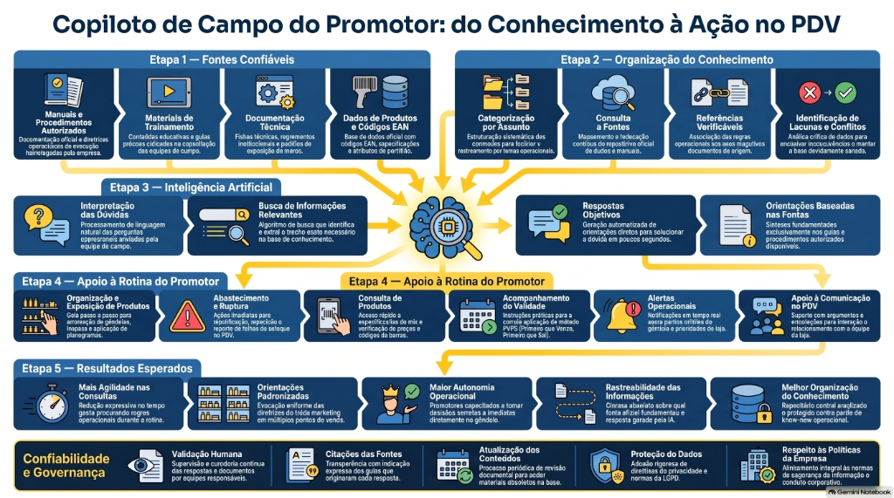

# Copiloto de Campo do Promotor — Inteligência Operacional no PDV

## 1. Objetivo
O **Copiloto de Campo do Promotor** é um projeto de assistente virtual baseado em Inteligência Artificial desenvolvido para transformar manuais operacionais, diretrizes corporativas e documentações técnicas de Trade Marketing, abastecimento e merchandising em orientações práticas, diretas e acionáveis para o promotor de vendas no Ponto de Venda (PDV) [2, 4, 6, 7].

## 2. Escopo do Projeto

### A. Incluso (Protótipo / Implementado)
- Base de conhecimento auditada sobre exposição em gôndola, planograma, validade (PVPS/FEFO), combate à ruptura e controle de estoques [2-4, 8].
- Atendimento a dúvidas operacionais do promotor via consulta em linguagem natural [7].
- Matriz de governança para distinção entre regras oficiais, interpretações operacionais e lacunas de informação [5, 9].
- Fluxos de escalonamento hierárquico e funcional para tratamento de exceções no PDV [9, 10].

### B. Fora do Escopo (Não Implementado / Proposta Futura)
- Tomada autônoma de decisões comerciais sem chancela da liderança do PDV ou do Trade Marketing [2, 6].
- Alteração direta de saldo de estoque em sistemas ERP de varejistas sem integração aprovada [4, 11, 12].
- Emissão de ordens de compra ou repactuação contratual sem autorização corporativa formal [1, 13].

## 3. Público-Alvo
- **Promotores de Vendas e Repositores de Campo**: Consulta rápida a dúvidas no corredor da loja [6, 7].
- **Supervisores e Coordenadores de Trade Marketing**: Auditoria de execução e acompanhamento de chamados/escalonamentos [6, 14].
- **Analistas de Processos e Governança**: Gestão do repositório, atualização de fontes e catálogo de regras [5, 15].

## 4. Funcionamento Previsto
1. **Entrada**: O promotor envia uma dúvida por texto ou voz via aplicativo móvel no PDV [7].
2. **Processamento**: O motor de IA consulta a base de conhecimento rastreável e verifica a existência de fontes oficiais.
3. **Saída**: Retorno estruturado em 5 seções (*Situação identificada*, *Orientação*, *Justificativa*, *Fonte* e *Próximo passo*).
4. **Tratamento de Exceção**: Se a informação for ausente ou conflitante, a IA sinaliza a limitação e orienta o escalonamento à liderança [5, 9].

## 5. Estrutura e Navegação do Repositório
- `README.md`: Visão geral e instruções do projeto.
- `docs/arquitetura.md`: Componentes conhecidos, fluxos e integrações planejadas.
- `docs/governanca-e-fontes.md`: Diretrizes de confiabilidade, versionamento e resolução de conflitos.
- `knowledge/`: Documentos operacionais separados por assunto.
- `prompts/prompt-principal.md`: Instruções de comportamento e diretrizes da IA.
- `tests/casos-de-teste.md`: Bateria de testes de validação funcional e de segurança.
- `sources/catalogo-de-fontes.md`: Inventário e rastreabilidade dos documentos do repositório.
- `assets/`: Pasta de mídias, áudios, infográficos e mapas mentais.
- `CHANGELOG.md`: Histórico de versões e alterações documentadas.

## 6. Recursos Multimídia e Artefatos do NotebookLM

### 📊 Infográfico Operacional: do Conhecimento à Ação no PDV

### 🎙️ Podcast e Áudio Overview
- 🎧 **Podcast de Campo:** [Ouvir "Copiloto de IA no Varejo" (.m4a)](assets/Copiloto_de_IA_no_varejo.m4a) — Visão executiva e operacional gerada via Google NotebookLM Audio Overview.

### 🎥 Vídeo Demonstrativo
- 🎬 **Vídeo de Ruptura:** [Assistir "Como a IA Resolve a Ruptura no PDV" (.mp4)](<assets/Como_a_IA_Resolve_a_Ruptura_no_PDV (1).mp4>) — Demonstração prática da tratativa de ruptura física e de exposição no chão de loja.

### 🗺️ Mapa Mental
- 🧠 **Mapa Mental Interativo:** [Acessar "Segundo Cérebro do Promotor de Campo" no NotebookLM](https://notebook.google.com/notebook/c3f03698-5961-4265-86ae-aff0bc14dbc6/artifact/f8999d71-e822-466b-884f-826c255076bd)

